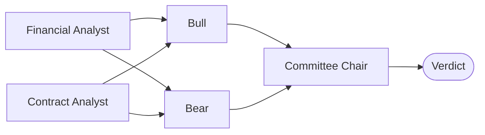

# AI Credit Committee

**Type a ticker. A committee of AI agents decides whether to lend to the company, and shows its work.**

The agents read the company's financials and its actual loan contract, then argue it out: a Bull
makes the case to lend, a Bear makes the case against, and a Chair writes the verdict. Two sliders
stress-test the company (earnings fall, refinancing costs rise). When a loan rule breaks, you can
re-run the committee and watch the verdict flip, with the contract sentence one click away.

| Baseline | Stress |
|---|---|
|  |  |

## How it works

### 1. A three-step agent pipeline



| Step | Agents | What they do |
|---|---|---|
| 1 | Financial Analyst, Contract Analyst (in parallel) | Summarize the numbers; state each loan rule and whether it passes |
| 2 | Bull, Bear (in parallel) | Argue to lend; argue not to lend |
| 3 | Committee Chair | Decides: `lend`, `dont_lend` or `lend_with_conditions` |

The pipeline is a LangGraph graph. Each agent is a Gemini call that returns structured JSON
(text plus sources), and each one streams to the dashboard over Server-Sent Events as it finishes.

### 2. A calculator the agents can't argue with

All the math is plain Python, not an LLM. The sliders update instantly, and every agent gets the
calculator's output in its prompt and is told to use only those numbers, so the debate always
matches the charts.

- **Net leverage** = (total debt − cash) ÷ EBITDA
- **Interest coverage** = EBITDA ÷ interest
- **Maturity wall as running liquidity.** Start with cash + undrawn revolver. Each year, add free
  cash flow and repay the debt that comes due. A year where the debt due is more than the
  liquidity left is flagged as a shortfall.
- **A breach costs the revolver.** If any loan rule fails, the revolver is removed from liquidity,
  because a borrower in breach can't draw it.

### 3. A Contract Analyst that reads the real contract

For Silgan, the Contract Analyst downloads the Fifth Amendment to the credit agreement from SEC
EDGAR (about 2 MB of HTML), strips the struck-through text (the filing is a blackline), and finds
the two covenant sections. Gemini returns the full covenant sentences and the leverage schedule.

Nothing is trusted until it is checked:

- every quote must appear word for word in the document, and
- the limit Gemini reads must match the hand-checked value in the company config.

If either check fails, the app falls back to the config. The result is cached, so the contract is
read once.

## Example: Silgan Holdings (SLGN)

Numbers from Silgan's FY2025 10-K. Loan rules from its credit agreement: net leverage at most
5.00x (§9.08) and interest coverage at least 3.00x (§9.07).

| | Baseline | Stress |
|---|---|---|
| Earnings decline | 0% | 30% |
| Refinancing rate | 4.34% (current) | 10% |
| EBITDA | $915M | $641M |
| Annual interest | $189M | $436M |
| Free cash flow | $423M | −$99M |
| Net leverage (max 5.00x) | 3.59x, pass | 5.12x, **fail** |
| Interest coverage (min 3.00x) | 4.83x, pass | 1.47x, **fail** |
| Revolver ($1.48B) | available | unavailable (breach) |
| Maturity wall | covered every year | 2028 shortfall: $1.38B due, $0 of liquidity |
| **Verdict** | **Lend** | **Don't lend** |

The leverage limit also tightens over time: 5.25x through 2025, 5.00x in 2026, 4.75x in 2027 and
4.50x from 2028, the same year $1.38B of debt comes due. The Bear uses that.

A fictional company, Pizza Co. (`PZCO`), is included as a simple second example.

## Tech stack

| Layer | Used |
|---|---|
| Frontend | Next.js 15 (App Router), React 19, TypeScript, Tailwind CSS |
| Charts | Recharts |
| Backend | Python, FastAPI, Pydantic |
| Agents | LangGraph |
| LLM | Gemini through the `google-genai` SDK, structured JSON output |
| Live updates | Server-Sent Events |
| Contract parsing | httpx, BeautifulSoup |
| Tests | pytest |

## Run it locally

You need Python 3.10+ and Node 18.18+.

```bash
# 1. Settings
cp .env.example .env        # then fill it in, see below

# 2. Backend, terminal 1
cd backend
python3 -m venv .venv
source .venv/bin/activate
pip install -r requirements.txt
uvicorn app.main:app --reload --port 8000

# 3. Frontend, terminal 2
cd frontend
npm install
npm run dev
```

Open http://localhost:3000. Run the tests with `cd backend && pytest`.

### `.env`

| Variable | What it is |
|---|---|
| `GEMINI_API_KEY` | Your Gemini API key. Not needed in demo mode. |
| `GEMINI_MODEL` | Gemini model name, for example `gemini-3.5-flash-lite` |
| `SEC_USER_AGENT` | Your name and email. SEC EDGAR requires it on every request. |
| `DEMO_MODE` | `1` replays saved runs. `0` calls Gemini live. |

**Demo mode.** With `DEMO_MODE=1` the app replays real committee runs saved in `data/demo_runs/`,
so it works with no API key. With `DEMO_MODE=0` the agents run live, and if a Gemini call fails
the app logs the error and falls back to the saved run. One live run makes five Gemini calls.

To save a new run: `cd backend && python -m app.agents.save_run SLGN 30 10`.

## Project structure

```
backend/
  app/main.py            FastAPI app
  app/models.py          Pydantic models for the API
  app/numbers/           calculator.py (all the math), routes.py (company, calc)
  app/agents/            gemini.py, briefing.py, contract.py, debate.py, graph.py, routes.py (SSE)
  tests/                 calculator and pipeline tests
frontend/
  app/                   home page, run/[ticker] dashboard
  components/            agent steps, KPI cards, maturity wall, sliders, rules panel, quote drawer, verdict
  lib/api.ts             every fetch and SSE call
data/
  companies/             one config per company (SLGN, PZCO)
  cache/                 the Contract Analyst's verified read of each contract
  demo_runs/             saved committee runs for demo mode
```

## Limitations

- **EBITDA is a proxy.** We use operating income + D&A. The contract's covenant EBITDA allows
  add-backs, so Silgan's real headroom differs from ours. This is an illustration, not a
  compliance test.
- **The data is a snapshot.** Figures come from the FY2025 10-K and do not update. Silgan has
  since repaid its 2026 notes, for example.
- **No refinancing is modeled.** The maturity wall assumes debt is repaid from cash, free cash
  flow and the revolver. A real borrower in good standing would refinance.
- **Company configs are researched by hand.** Financials, maturities and rule thresholds were
  entered manually for each company. Only the contract quotes are extracted automatically.
- **Saved runs match two slider positions.** In demo mode, any other position replays the
  baseline run (if every rule passes) or the stress run, so the text may not match the chart.
- **The Chair follows a rule.** Any failed loan rule means "don't lend". That keeps the verdict
  consistent, at the cost of nuance.

## Roadmap

- Find the credit agreement for any ticker automatically
- Live EDGAR ingestion in place of hand-entered financials
- Apply the covenant step-down year by year, not only the current limit
- Deployment (Vercel for the frontend, Railway for the backend)

## Built by

Hashir Ali and Hameed, at Hack Knight Fall 2026.
